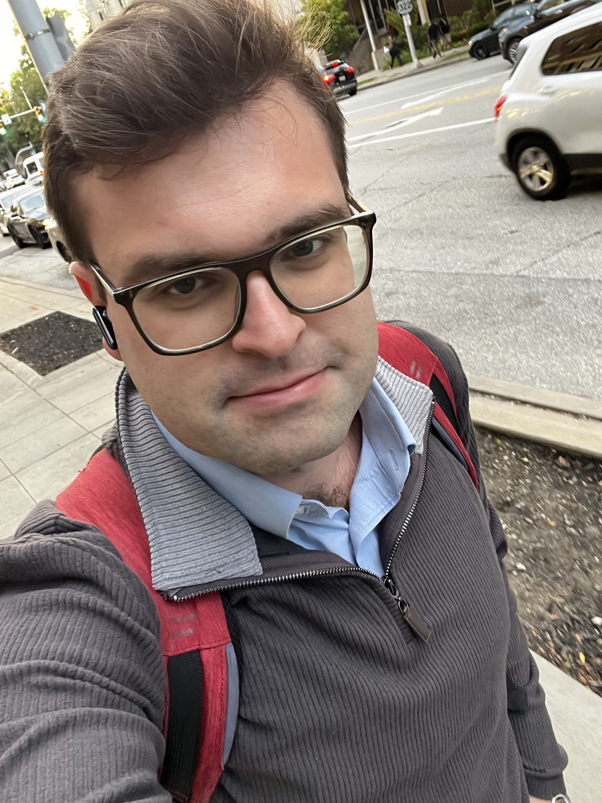

::: {.home-hero}
::: {.hero-copy}
::: {.eyebrow}
NEUROLOGY / NEUROIMMUNOLOGY
:::

# Nikolay Neofidov, MD {.hero-name}

::: {.hero-role}
Neuroimmunology Fellow  
Mellen Center, Cleveland Clinic
:::

::: {.hero-statement}
Studying biomarkers of multiple sclerosis progression.
:::

I am a neurologist based in Cleveland, Ohio. My primary research interest is identifying and evaluating biological markers of progression in multiple sclerosis, with the goal of better understanding disability accumulation and informing patient care.

::: {.hero-actions}
[Explore my research](research.qmd){.btn .btn-primary}
[Download CV](assets/Nikolay-Neofidov-CV.pdf){.btn .btn-outline-primary}
:::

::: {.small-links}
[Email](mailto:neofidov@gmail.com) / [GitHub](https://github.com/Wuweiniko)
:::
:::

::: {.hero-photo}
{.portrait}
:::
:::

::: {.home-bottom}
::: {.eyebrow}
ABOUT ME
:::

## Clinical experience. Research perspective.

I am currently a neuroimmunology fellow at Cleveland Clinic’s Mellen Center. I completed my neurology residency at the University of Louisville in June 2026, following earlier clinical training and work in Saint Petersburg, Russia.

My previous research has included cognitive assessment, comorbidity, and treatment outcomes in multiple sclerosis. These experiences inform my current focus on biomarkers of disease progression.

[View education and experience →](experience.qmd)
:::
